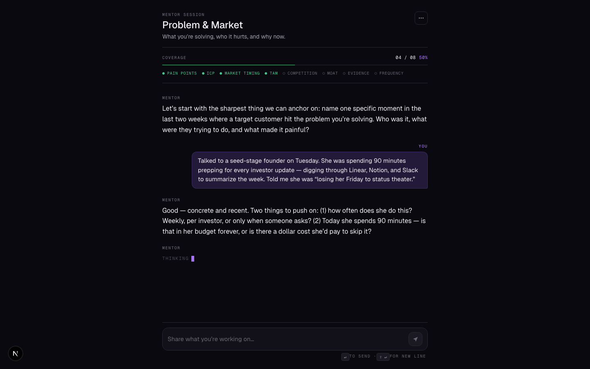
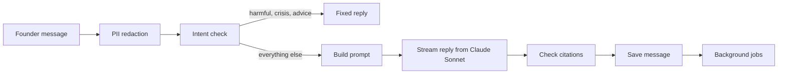

# Entity

Entity is a web app where startup founders talk to an AI mentor that asks investor-style questions about their company. It saves the conversation, pulls structured facts out of what the founder says, and uses the transcripts to write feedback.



## How it works

The app has two parts: a Next.js frontend in `apps/web` and a FastAPI backend in `backend`. They share a Postgres database (Supabase, with the pgvector extension). Sign-in is handled by Clerk.

### 1. Sign-up and onboarding

1. A founder signs up through Clerk on the frontend.
2. Clerk sends a webhook to `POST /api/webhooks/clerk` (`backend/src/api/auth.py`). The backend checks the signature with `svix`, records the event id so a replayed webhook is ignored, and creates or updates a row in `founders` plus an empty `startup_profiles` row.
3. The onboarding pages (`apps/web/src/app/(onboarding)`) collect the company name, one-liner and stage. When a founder saves a GitHub username in their profile (`PATCH /api/founders/me`), `backend/src/enrichment/github.py` fetches the public profile and top repos in the background.
4. A founder can also upload a pitch deck PDF (`backend/src/api/deck.py`, 5 MB limit). The PDF is sent to Claude in a background task (`backend/src/llm/deck_extract.py`), which returns sections like problem, market, traction and ask. Those sections are added to the mentor's context later.

### 2. Authenticated requests

- `apps/web/src/proxy.ts` is the Clerk middleware that blocks non-public routes for signed-out users.
- Most API calls go through a catch-all Next.js route, `apps/web/src/app/api/[...path]/route.ts`. It gets a Clerk token and forwards the request to FastAPI with a `Bearer` header.
- The chat stream skips that proxy. The browser calls FastAPI directly with the Clerk token (`apps/web/src/lib/chat-stream.ts`) and reads the streamed reply line by line, so the reply does not pass through the Next.js server.
- On the backend, `verify_clerk_jwt` in `backend/src/core/dependencies.py` checks every token against Clerk's JWKS. Keys are cached and matched by `kid`, with one forced refresh if the key is not found (this covers Clerk rotating keys).

### 3. Structured mentor sessions

Conversations are split into four sessions, each defined as a `SessionBlueprint` in `backend/src/llm/mentor_sessions.py`:

| Session              | Topics it tries to cover                                |
| -------------------- | ------------------------------------------------------- |
| The Big Picture      | founder background, product, ideal customer, why now    |
| The Problem & Market | pain points, market size, competition, moat             |
| The Business         | pricing, traction, go-to-market, team                   |
| The Ask              | round size, terms, investor pipeline, other help needed |

Each blueprint has its own system prompt suffix, starter questions, and a rubric used to judge coverage. There is also a "deep dive" session that targets one weak area. `GET /api/sessions/deep-dive/recommendation` picks it by finding the founder's lowest category score in `signal_scores` (`backend/src/db/repositories/sessions_repository.py`), and falls back to the "problem" category when there are no scores yet.

### 4. One chat turn

This is the main pipeline, in `backend/src/api/chat.py` (`POST /api/chat/stream`):



1. **Redact.** `backend/src/llm/redact.py` replaces SSNs, card numbers, emails and phone numbers with placeholders before anything is stored or sent to a model.
2. **Classify intent.** `backend/src/llm/safety.py` first lets short replies through without a model call (a list of phrases like "ok" or "why?", plus any message of three words or fewer with no digits), so they are never flagged. Anything else goes to Claude Haiku, which labels it as coaching, off topic, harmful, crisis, or a request for investment advice. If that call fails, the message is treated as coaching. Harmful, crisis and investment-advice messages get a fixed reply and no further model call. Off-topic messages still go to the mentor, so it can steer back with the earlier conversation in mind.
3. **Build the prompt.** `backend/src/llm/context_builder.py` puts together the system prompt from several blocks: the mentor identity, the founder profile, the session's focus, the deck summary (once a deck has been processed), matching patterns and stage benchmarks from the database, and (if enabled) research paper excerpts. The first two blocks are marked with Anthropic `cache_control` because they rarely change between turns. The last 20 messages are added as history, with user text wrapped in `<user_message>` tags.
4. **Stream.** The reply is streamed from Claude Sonnet and sent to the browser as server-sent events (`session`, `token`, `citations`, `done`, `error`).
5. **Check citations.** If research excerpts were included, `backend/src/rag/citations.py` removes any `[N]` reference the model made up that does not match a retrieved excerpt.
6. **Save.** The founder's redacted message is saved before the model call. The assistant message is saved in a `finally` block, so a partial reply is still stored (and marked partial) if the client disconnects.
7. **Background jobs** (FastAPI `BackgroundTasks`, so the user does not wait for them):
   - `extract_signals` (Haiku, via the `instructor` library) pulls structured facts like MRR or team size out of the founder's message and writes them to `session_signals`.
   - `judge_session_coverage` (`backend/src/llm/judges.py`, Haiku) rates how much of the session's topics have been covered from 0 to 100. The stored score only goes up, and the session is marked "ready to complete" once it passes a threshold after a minimum number of turns (`COVERAGE_COMPLETION_THRESHOLD`, `COVERAGE_MIN_TURNS` in `backend/src/core/config.py`).
   - After three turns, `generate_cold_read` (Sonnet) writes a one-time "cold read": a summary of what the mentor heard, three investor pushbacks, and three questions the founder cannot answer yet. Cold reads can be shared through a public slug (`/cold-read/[slug]`).

### 5. Research grounding (RAG)

Retrieval over research papers is optional and controlled by `RAG_MODE`: `off` (the default), `mentor_only` (excerpts in chat only) or `full` (chat and the mentor summary). Any mode other than `off` needs `OPENAI_API_KEY`, and the config refuses to load without it.

1. `backend/scripts/ingest_papers.py` reads PDFs from `backend/data/papers/` (the PDFs themselves are gitignored).
2. `backend/src/rag/parsing.py` extracts text with `pypdf`, splits it on common paper headings (abstract, methods, results, ...) and drops any line that contains an email address (usually author contact details).
3. `backend/src/rag/chunking.py` splits each section into chunks of about 1500 tokens with 200 tokens of overlap, using the `o200k_base` tokenizer from `tiktoken`.
4. Chunks are embedded with OpenAI `text-embedding-3-small` (`backend/src/llm/embeddings.py`) and stored in `research_chunks` as 1536-dim pgvector columns. Re-ingesting is skipped when the file hash and chunking version have not changed.
5. At query time, `backend/src/rag/retriever.py` embeds the question and runs a cosine-distance search in Postgres, dropping matches below a minimum similarity. `backend/src/rag/grounding.py` wraps the top chunks in numbered tags so the model can cite them as `[1]`, `[2]`, and so on.
6. In chat, `backend/src/rag/chat_grounding.py` fetches the top 4 chunks for the founder's message. If retrieval fails for any reason, it returns no excerpts, so the chat still answers instead of failing the request.

### 6. Scores and summary

- The scores page (`apps/web/src/app/(dashboard)/dashboard/scores`) shows an overall number and eight categories (founder, market, problem, competition, product, traction, pricing, team) as a Recharts radar chart. It reads the latest row of `signal_scores`. In this version that table is filled by the demo seeders (`backend/scripts/seed_demo.py` and `POST /api/dev/seed-demo`); there is no automatic scoring job yet.
- `GET /api/scores/mentor-summary` (`backend/src/api/scores.py`) loads the transcripts of the four core sessions (deep dives are skipped) and runs two model calls in parallel: a Sonnet summary with a headline, strengths, weaknesses and tips, and a Haiku call that writes a short rationale for each category. When `RAG_MODE=full`, `backend/src/rag/summary_grounding.py` runs one broad search built from the company one-liner and the transcripts and adds those excerpts to the summary prompt.

### 7. Scheduled jobs

`backend/src/jobs/scheduler.py` starts an APScheduler instance when the API boots:

- `send_welcome_emails` every 5 minutes, and `send_reengagement_emails` every hour for founders who signed up 40 to 72 hours ago, have not sent a message since their first hour, and have open questions from their cold read. Both send through Resend and log to `email_sends` so nobody gets the same email twice.
- `purge_deleted_founders` nightly (03:00 server time), which hard-deletes accounts that were soft-deleted more than 30 days ago.

### Other pieces

- **Data isolation.** Supabase row-level security policies read the user from settings that only Supabase's own REST layer fills in, and this backend talks to Postgres directly through `asyncpg`. So row-level security is turned off on the main tables, and the queries in `backend/src/db/repositories/` filter by `founder_id` instead. A unit test (`backend/tests/unit/test_tenant_filter_lint.py`) parses that SQL with `sqlglot` and fails if a query on a founder-owned table has no such filter. The reasoning is in `docs/adr/2026-04-12-rls-disabled-app-layer-isolation.md`.
- **Account controls.** Founders can export their data (`GET /api/founders/me/export`), delete all sessions, or reset their account.
- **Evals.** `backend/evals/golden/` holds YAML test cases for the mentor prompt (vague traction, TAM pushback, jailbreak attempts, crisis signals, and so on). `backend/evals/run_evals.py` runs them against Claude.
- **Rate limiting** uses `slowapi` (for example 20 chat messages per minute per client IP). Logging is structured with `structlog`, errors go to Sentry, and product events go to PostHog.

## Project layout

```
apps/web/            Next.js app (marketing page, auth, onboarding, dashboard, chat)
  src/app/           Routes, grouped by (marketing), (auth), (onboarding), (dashboard)
  src/components/    Chat, sessions, scores, profile and settings components
  src/lib/           SSE chat client, React Query hooks, Zod schemas
  e2e/               Playwright tests
packages/ui/         Shared UI components and design tokens (@entity/ui)
backend/
  src/api/           FastAPI routers (chat, sessions, scores, deck, founders, webhooks)
  src/llm/           Claude client, prompts, context builder, extractors, judges, safety
  src/rag/           PDF parsing, chunking, retrieval, grounding, citation checks
  src/db/            asyncpg pool and repositories
  src/jobs/          Scheduled email and purge jobs
  scripts/           Seed loading, demo data, paper ingestion
  seeds/             Founder patterns and stage benchmarks (YAML)
  evals/             Golden test cases for the mentor prompt
  tests/             pytest suite
supabase/            SQL migrations and local Supabase config
docs/                Architecture decision records and screenshots
```

## Tech stack

- **Frontend:** Next.js 16, React 19, TypeScript, Tailwind CSS 4, TanStack Query, React Hook Form, Zod, Motion, GSAP, Three.js, Recharts
- **Backend:** Python 3.12, FastAPI, Pydantic v2, asyncpg, APScheduler, slowapi, structlog
- **AI:** Anthropic Claude (Sonnet for conversation and summaries, Haiku for classification, extraction and judging), Instructor for structured output, OpenAI embeddings for RAG
- **Data:** Supabase Postgres with pgvector
- **Auth:** Clerk (JWT verified against JWKS, webhooks verified with Svix)
- **Other services:** Resend (email), Sentry, PostHog
- **Tooling:** pnpm workspaces, uv, Vitest, Playwright, pytest, Ruff, Pyright, GitHub Actions

## Running it

You need Node.js 22+, pnpm 9+, Python 3.12+, [uv](https://docs.astral.sh/uv/), the [Supabase CLI](https://supabase.com/docs/guides/local-development/cli/getting-started) and Docker (the Supabase CLI uses it).

```bash
# install dependencies
pnpm install
cd backend && uv sync && cd ..

# start local Postgres (runs migrations in supabase/migrations)
supabase start

# config
cp .env.example .env
```

Fill in `.env`. The backend refuses to start without these:

- `DATABASE_URL`
- `CLERK_JWKS_URL`, `CLERK_SECRET_KEY`, `CLERK_WEBHOOK_SECRET`
- `ANTHROPIC_API_KEY`

The backend reads `backend/.env` or the root `.env`. The frontend needs `NEXT_PUBLIC_CLERK_PUBLISHABLE_KEY`, `CLERK_SECRET_KEY` and `NEXT_PUBLIC_API_URL` (for example `http://localhost:8000`). Next.js only loads env files from its own folder, so put those in `apps/web/.env.local`. The Clerk app also needs a JWT template named `backend`, since the frontend asks for a token with that template.

Optional: `CLERK_ISSUER` (the token issuer is checked when it is set), `RAG_MODE` and `OPENAI_API_KEY` (research grounding), `RESEND_API_KEY` (emails), `SENTRY_DSN` / `NEXT_PUBLIC_SENTRY_DSN`, `POSTHOG_API_KEY` / `NEXT_PUBLIC_POSTHOG_KEY`.

Load the mentor's pattern and benchmark data, then start both servers:

```bash
cd backend && uv run python -m scripts.load_seeds

# terminal 1: API on :8000
cd backend && uv run uvicorn src.main:app --reload --port 8000

# terminal 2: web app on :3000
pnpm --filter @entity/web dev
```

To try the RAG path, put PDFs in `backend/data/papers/`, set `RAG_MODE=full` and `OPENAI_API_KEY`, then run `cd backend && uv run python -m scripts.ingest_papers`.

Tests and checks:

```bash
pnpm --filter @entity/web test          # Vitest
pnpm --filter @entity/ui test
pnpm --filter @entity/web test:e2e      # Playwright
cd backend && uv run pytest
cd backend && uv run ruff check . && uv run pyright
```

`DEPLOY.md` describes the hosted setup (Vercel for the web app, Railway for the API using `backend/Dockerfile`, Supabase for the database).
